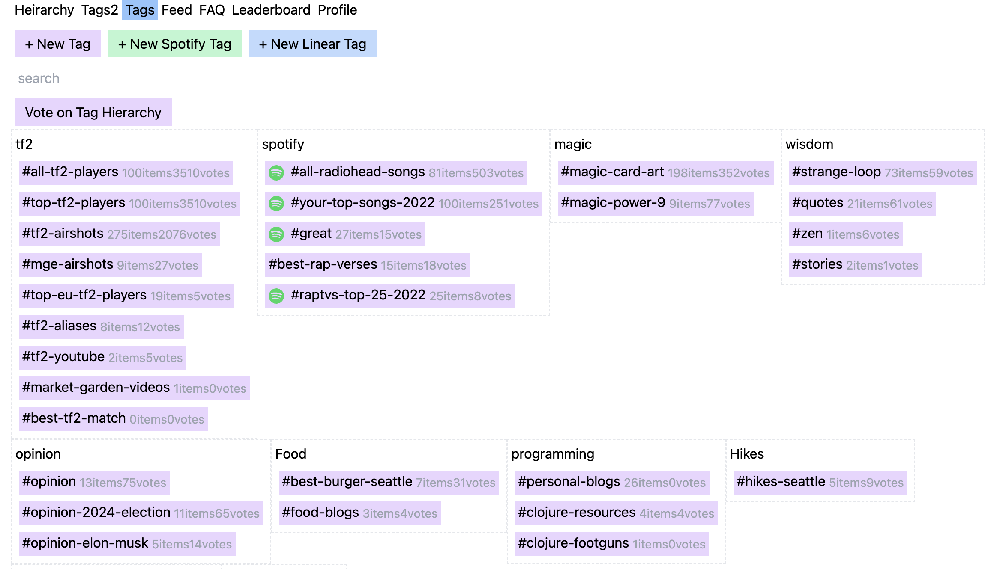

# sorter
clojure, rust, and react based pair-wise staunchly democratic social media application



## project info

### contributors
- `@thmorriss`  
  [](https://wakatime.com/badge/user/116b65a9-c932-4d5d-a682-331cd988d6f0/project/e7669bfe-a191-44f0-b3eb-02cdebe8c923)
- `@zudsniper`  
  [](https://wakatime.com/badge/user/72fdcd5a-a9d0-4016-b00f-3f3d6fb2514a/project/e1e0cfd8-9d79-4d5f-acdf-80064f6e2613)
- `@laralove143`  
  [](https://wakatime.com/badge/user/63c0a54b-c8c3-4d1d-8880-80300b937662/project/161a1426-2ddd-400f-b45d-7206650e2858)

### deployments
- [](https://github.com/sorterisntonline/sorter/actions/workflows/deploy.yml) (prod)
- [](https://github.com/sorterisntonline/sorter/actions/workflows/deploy.yml) (staging)

## installation

### linux development dependencies
```sh
# base system packages
sudo apt install -y git curl jq rsync rlwrap pkg-config libssl-dev build-essential openjdk-17-jdk

# node.js v21.x
curl -fsSL https://deb.nodesource.com/setup_21.x | sudo -E bash -
sudo apt install -y nodejs

# rust
curl --proto '=https' --tlsv1.2 -sSf https://sh.rustup.rs | sh

# clojure
curl -L -O https://github.com/clojure/brew-install/releases/latest/download/linux-install.sh
chmod +x linux-install.sh
sudo ./linux-install.sh
rm linux-install.sh

# docker
sudo apt install -y docker.io
sudo systemctl enable --now docker
```

### optional tools
- babashka
- calva vs code extension
- restore terminals vs code extension (pre-configured to auto-start services after initial setup)

### repository setup
```sh
git clone git@github.com:sorterisntonline/sorter.git
cd sorter
```

## development setup

1. **database initialization**:
```sh
cd borter/database
# start postgres with docker (optional: add initial data dump from https://github.com/sorterisntonline/db_dump)
./run-postgres.sh [path/to/dump.sql]

# Run migrations via borter (in separate terminal)
cd ../..
cd borter/
cp env.example .env
./run.sh
```
- First run creates empty database schema through migrations
- SQL dump is optional for initial test data (get from https://github.com/sorterisntonline/db_dump)
- Creates admin user: `admin`/`admin` through migrations
- Container persists data between runs (only need dump for initial test data)

2. **environment configuration**:
create `dev.env` with development settings:
```env
AUTO_LOGIN=true  # automatic admin authentication
NO_RATE_LIMITS=false  # (optionally) disable rate limits for admin
```

## development features

### auto-login
when `AUTO_LOGIN=true` in your environment:
- automatically authenticates as admin user
- bypasses login screen during development

### rate limit control
when `NO_RATE_LIMITS=true` in your environment:
- disables all rate limiting for admin account
- useful for testing high-volume operations

## running services

the vscode `restore terminals` extension is pre-configured to automatically start these services:
```sh
# clojure backend
cd borter/
./run.sh

# rust backend
cd rustsorter/
cp env.example .env
cargo run

# main frontend
cd forter/
npm install
npm run dev
```

access application at: `http://localhost:3000`

*note: terminal restore configuration requires manual first-time service startup before it can work*
